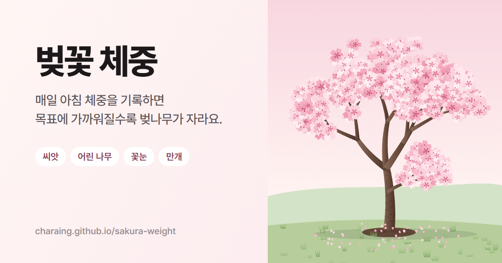

# 벚꽃 체중

**앱 열기:** https://charaing.github.io/sakura-weight/

매일 아침 몸무게를 기록하면 목표에 가까워질수록 빈 땅의 씨앗이 벚나무로 자라고, 목표에 닿으면 꽃이 활짝 피는 체중 기록 앱입니다.

- 0% 빈 땅 → 15% 어린 벚나무 → 50% 꽃눈 → 100% 만개
- 기록 달력, 체중 그래프, 예상 도착일, 배지, 정원(완료한 나무 모음)
- **팁 400개**: 야식, 가짜 배고픔, 정체기, 폭식, 회식 등 20가지 분야의 상황별 원인·해결법·근거 자료(논문·진료지침·책 71건). 검색, 저장, '해본 것' 체크, 공유
- **충동 넘기기**: 지금 상태 16가지(배고픔, 단 것·짠 것 당김, 스트레스, 우울, 외로움, 술, 생리 전 등) 중 하나를 고르고 3/10/20분 동안 벚꽃이 숨 쉬는 호흡 타이머로 충동을 지켜보기. 결과는 통계 탭에 쌓여요
- **물 기록**: 홈에서 벚꽃 8송이를 채우며 하루 물 8잔 체크, 시간대에 맞춘 추천과 오늘의 팁
- 새 배지 4개: 충동 넘기기, 충동 10번, 물 8잔, 해본 방법 10개
- 서버 없이 정적 파일만으로 동작하며, 기록은 브라우저(localStorage)에 저장됩니다.
- 기록 사이 체중은 하루에 1kg까지만 바뀔 수 있어요 (며칠 건너뛰면 그만큼 허용).
- 서울 시간과 날씨(Open-Meteo)를 보여주고, 날씨에 따라 배경에 비나 눈이 내려요.
- 휴대폰에서 "홈 화면에 추가"하면 앱처럼 쓸 수 있어요.
